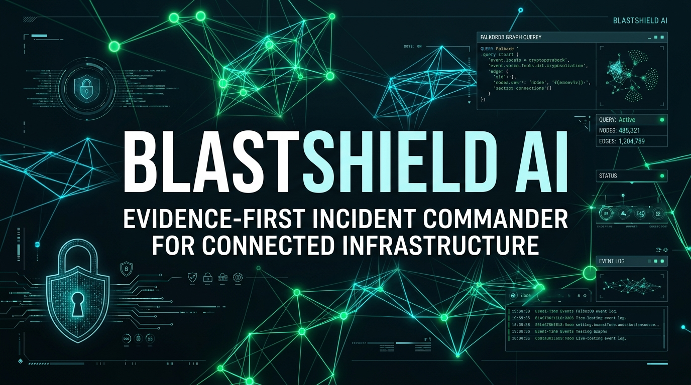
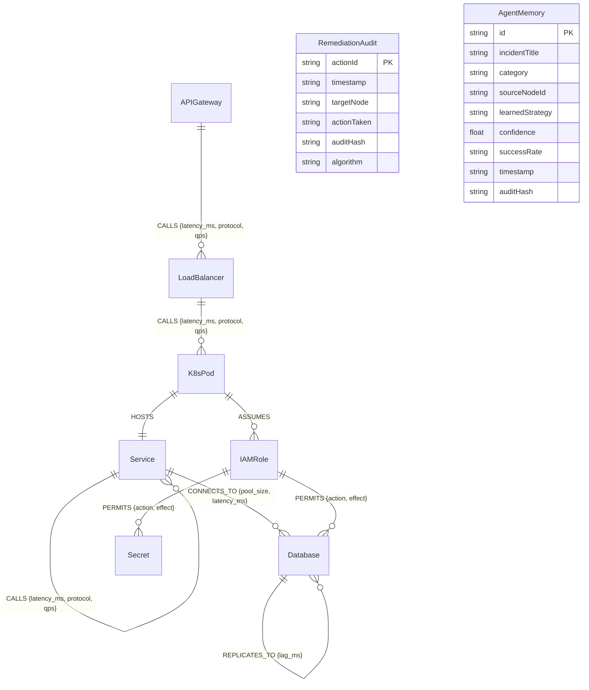
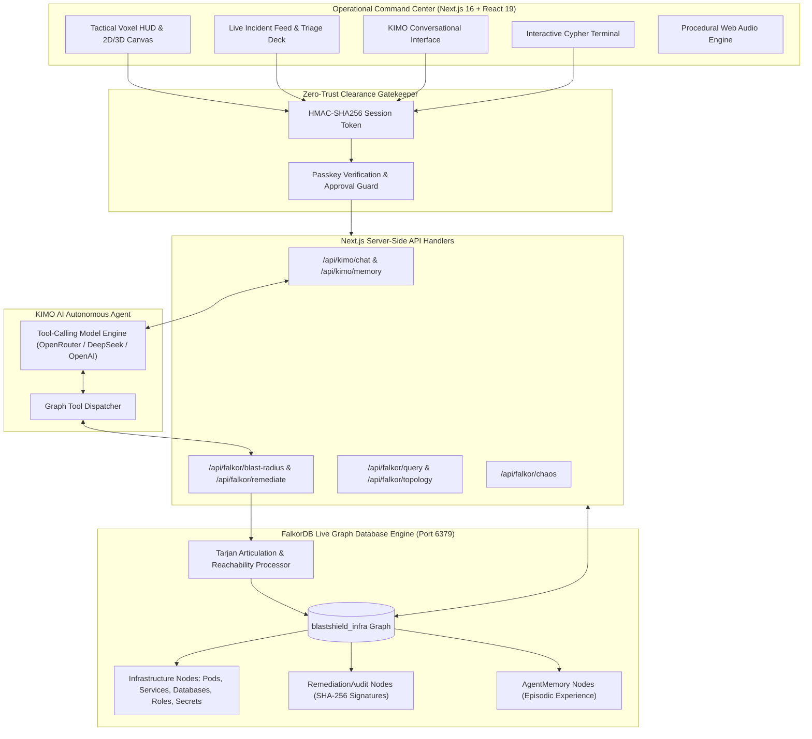

<p align="center">
  
</p>

<p align="center">
  <a href="https://www.falkordb.com/"></a>
  <a href="https://nextjs.org/"></a>
  <a href="https://www.typescriptlang.org/"></a>
  <a href="https://openrouter.ai/"></a>
  
  
</p>

---

## Table of Contents

- [Executive Summary](#executive-summary)
- [Setup Instructions](#setup-instructions)
- [Graph Data Model](#graph-data-model)
- [FalkorDB Graph Hacks Challenge Alignment](#falkordb-graph-hacks-challenge-alignment)
- [System Architecture](#system-architecture)
- [Mathematical & Graph-Theoretical Engine](#mathematical--graph-theoretical-engine)
- [KIMO Autonomous Agent: Tool-Calling Protocol](#kimo-autonomous-agent-tool-calling-protocol)
- [Cryptographic Audit Trail & Dual-Layer Memory](#cryptographic-audit-trail--dual-layer-memory)
- [Zero-Trust Security Clearance Architecture](#zero-trust-security-clearance-architecture)
- [Command Deck & Visual Capabilities](#command-deck--visual-capabilities)
- [API Reference](#api-reference)
- [Hackathon Judge Demo Walkthrough](#hackathon-judge-demo-walkthrough)
- [Technology Stack](#technology-stack)
- [License](#license)

---

## Executive Summary

**BlastShield AI** is an evidence-first, autonomous incident commander for modern connected cloud infrastructure. Powered directly by **FalkorDB**, it replaces guesswork and static dashboards with a live graph intelligence layer.

Modern cloud outages and security breaches are fundamentally graph problems: a compromised Kubernetes pod assumes an IAM role, which decrypts a credential in KMS, granting access to an internal database cluster, which replicates across regions. Flat log collectors and traditional APM tools miss these multi-hop traversal paths entirely.

BlastShield connects **KIMO** (an autonomous tool-calling AI agent) directly to a live FalkorDB graph over the Redis wire protocol. KIMO performs real-time multi-hop Cypher traversals, computes graph articulation points using Tarjan's algorithm to pinpoint critical choke points, evaluates downstream blast impact, and proposes surgical containment actions—executing live database mutations only after explicit human operator authorization. Every action is cryptographically signed and stored in the graph as both an immutable audit node and an episodic memory for future retrieval.

---

## Setup Instructions

Follow these step-by-step instructions to get BlastShield AI running locally with a live FalkorDB graph engine.

### 1. Prerequisites

Before starting, ensure your host environment has the following installed:

| Requirement | Minimum Version | Verification Command | Description |
|---|---|---|---|
| **Node.js** | `v20.0.0` or higher | `node -v` | Server runtime environment |
| **npm** | `v10.0.0` or higher | `npm -v` | Node package manager |
| **Docker** | `24.0.0` or higher | `docker -v` | Container runtime for FalkorDB |
| **Docker Compose** | `v2.20.0` or higher | `docker compose version` | Multi-container orchestration |

*(Note: If you run FalkorDB natively or on an external host, Docker is not required on the local machine).*

---

### 2. Clone the Repository & Install Dependencies

```bash
# Clone the repository
git clone https://github.com/sandman-sh/BlastShield-AI.git

# Enter the project directory
cd BlastShield-AI

# Install application dependencies
npm install
```

---

### 3. Launch FalkorDB

Start the official FalkorDB container using the included `docker-compose.yml`:

```bash
docker compose up -d falkordb
```

#### Verify FalkorDB Connectivity
Test that FalkorDB is running and accepting Redis wire protocol connections on port `6379`:

```bash
# Using redis-cli (Linux / macOS / WSL)
redis-cli -h 127.0.0.1 -p 6379 PING

# Or using PowerShell on Windows
Test-NetConnection -ComputerName 127.0.0.1 -Port 6379
```
*Expected response: `PONG` or `TcpTestSucceeded : True`.*

---

### 4. Configure Environment Variables

Create your local `.env` configuration file from the provided `.env.example`:

```bash
cp .env.example .env
```

Open `.env` and configure your credentials and connection endpoints:

```env
# =======================================================
# BLASTSHIELD AI — ENTERPRISE CONFIGURATION
# =======================================================

# FalkorDB Database Connection (Running via Docker / Local / Cloud)
FALKORDB_HOST=127.0.0.1
FALKORDB_PORT=6379
FALKORDB_GRAPH=blastshield_infra

# Application Server Port & Base URL
PORT=3002
NEXT_PUBLIC_APP_URL=http://localhost:3002

# AI Agent Provider for KIMO (Any OpenAI-compatible provider: OpenRouter, DeepSeek, OpenAI)
AI_BASE_URL=https://openrouter.ai/api/v1
AI_API_KEY=your_openrouter_or_openai_api_key
AI_MODEL=deepseek/deepseek-chat

# Security Clearance Passkey (Used for Incident Commander authorization)
INCIDENT_COMMANDER_PASSKEY=BLASTSHIELD-ALPHA-77
```

#### Environment Variables Reference

| Variable | Required | Default | Description |
|---|---|---|---|
| `FALKORDB_HOST` | Yes | `127.0.0.1` | Host address of the FalkorDB instance |
| `FALKORDB_PORT` | Yes | `6379` | Port number of the FalkorDB instance |
| `FALKORDB_GRAPH` | Yes | `blastshield_infra` | Primary graph identifier inside FalkorDB |
| `PORT` | No | `3002` | Port on which Next.js will listen |
| `NEXT_PUBLIC_APP_URL` | No | `http://localhost:3002` | Public URL for header referrers |
| `AI_BASE_URL` | Yes | `https://openrouter.ai/api/v1` | OpenAI-compatible endpoint URL |
| `AI_API_KEY` | Yes | — | Secret API key for the AI model provider |
| `AI_MODEL` | Yes | `deepseek/deepseek-chat` | Tool-calling model identifier |
| `INCIDENT_COMMANDER_PASSKEY` | Yes | `BLASTSHIELD-ALPHA-77` | Operator clearance passkey |

---

### 5. Launch the Development Server

Start the Next.js App Router application:

```bash
npm run dev
```

The application is now operational at **[http://localhost:3002](http://localhost:3002)**.

---

### 6. Verify System Health

Verify that both FalkorDB and the AI agent are active and healthy:

```bash
curl http://localhost:3002/api/health
```

#### Expected JSON Response:
```json
{
  "ok": true,
  "service": "blastshield-ai",
  "agent": {
    "configured": true,
    "baseUrl": "https://openrouter.ai/api/v1",
    "model": "deepseek/deepseek-chat"
  },
  "falkor": {
    "connected": true,
    "host": "127.0.0.1",
    "port": 6379,
    "graphName": "blastshield_infra",
    "nodeCount": 21,
    "edgeCount": 23,
    "version": "FalkorDB graph engine",
    "latencyMs": 2.52,
    "availableGraphs": ["blastshield_infra"]
  },
  "checkedAt": "2026-10-18T18:50:00.000Z"
}
```

---

### 7. Initialize Infrastructure Graph

The graph is automatically seeded upon first load. To manually reset or re-seed the topology at any time, execute:

```bash
curl -X POST http://localhost:3002/api/falkor/seed
```
*Or click the **RESET TOPOLOGY** button in the top navigation bar of the application.*

---

## Graph Data Model

BlastShield models enterprise cloud infrastructure as a typed property multigraph inside **FalkorDB**. The data model captures physical compute, microservices, data stores, IAM credentials, cryptographic secrets, cryptographic audit records, and agent episodic memories.

### Entity-Relationship Diagram



---

### Node Labels & Schema Specification

Every entity in FalkorDB belongs to a typed node label with strict property attributes:

| Label | Role | Properties | Types & Constraints | Tier |
|---|---|---|---|---|
| `APIGateway` | Ingress Entrypoint | `id`, `name`, `tier`, `status`, `qps`, `region` | `id: String (PK)`, `tier: Int`, `status: Enum`, `qps: Int`, `region: String` | Tier 1 |
| `LoadBalancer` | Traffic Distributor | `id`, `name`, `tier`, `status`, `qps`, `region` | `id: String (PK)`, `tier: Int`, `status: Enum`, `qps: Int`, `region: String` | Tier 1 |
| `Service` | Core Microservice | `id`, `name`, `tier`, `status`, `qps`, `region` | `id: String (PK)`, `tier: Int`, `status: Enum`, `qps: Int`, `region: String` | Tier 1 / 2 / 3 |
| `K8sPod` | Container Workload | `id`, `name`, `tier`, `status`, `cpu_usage`, `region` | `id: String (PK)`, `tier: Int`, `status: Enum`, `cpu_usage: Int`, `region: String` | Tier 1 / 2 |
| `Database` | Primary Store / Cache | `id`, `name`, `tier`, `status`, `region` | `id: String (PK)`, `tier: Int`, `status: Enum`, `region: String` | Tier 1 / 2 |
| `IAMRole` | Identity Grant | `id`, `name`, `tier`, `status`, `region` | `id: String (PK)`, `tier: Int`, `status: Enum`, `region: String` | Tier 1 |
| `Secret` | Keys & Master Passwords | `id`, `name`, `tier`, `status`, `region` | `id: String (PK)`, `tier: Int`, `status: Enum`, `region: String` | Tier 1 |
| `RemediationAudit` | Cryptographic Log | `actionId`, `timestamp`, `targetNode`, `actionTaken`, `auditHash`, `algorithm` | `actionId: String (PK)`, `auditHash: String (SHA-256)`, `algorithm: String` | Governance |
| `AgentMemory` | Episodic Fact | `id`, `incidentTitle`, `category`, `sourceNodeId`, `learnedStrategy`, `confidence`, `successRate`, `timestamp`, `auditHash` | `id: String (PK)`, `confidence: Float`, `auditHash: String` | Memory |

#### Node Status Enum Values
- `HEALTHY`: Normal runtime state.
- `COMPROMISED`: Breach origin entity identified by anomaly telemetry.
- `AT_RISK`: Downstream entity reachable through active blast paths.
- `QUARANTINED`: Isolated entity; dangerous edges removed via Cypher.
- `ISOLATED`: Service drained from traffic routing.
- `FAILOVER`: Standby replica promoted to active primary state.

---

### Relationship Types & Schema Specification

| Relationship | Source Label | Target Label | Operational Semantics | Attributes |
|---|---|---|---|---|
| `CALLS` | `APIGateway`, `LoadBalancer`, `Service` | `LoadBalancer`, `K8sPod`, `Service` | Network RPC or HTTP request path | `protocol: String`, `latency_ms: Int`, `qps: Int` |
| `HOSTS` | `K8sPod` | `Service` | Logical microservice running inside physical container | None |
| `CONNECTS_TO` | `Service` | `Database` | Active connection pool | `pool_size: Int`, `latency_ms: Int` |
| `ASSUMES` | `K8sPod` | `IAMRole` | Workload identity role assumption | None |
| `PERMITS` | `IAMRole` | `Secret`, `Database` | IAM authorization grant | `action: String`, `effect: String` |
| `REPLICATES_TO` | `Database` | `Database` | Asynchronous database replication | `lag_ms: Int` |

---

### FalkorDB Indexing Strategy

For high-speed real-time traversals and lookups on large graphs, FalkorDB indexes the primary entity keys:

```cypher
CREATE INDEX FOR (n:APIGateway) ON (n.id);
CREATE INDEX FOR (n:LoadBalancer) ON (n.id);
CREATE INDEX FOR (n:Service) ON (n.id);
CREATE INDEX FOR (n:K8sPod) ON (n.id);
CREATE INDEX FOR (n:Database) ON (n.id);
CREATE INDEX FOR (n:IAMRole) ON (n.id);
CREATE INDEX FOR (n:Secret) ON (n.id);
CREATE INDEX FOR (a:RemediationAudit) ON (a.actionId);
CREATE INDEX FOR (m:AgentMemory) ON (m.id);
```

---

### Baseline Infrastructure Graph Definition

The baseline infrastructure topology seeded into FalkorDB represents a multi-tier production environment:

```cypher
CREATE
  // Ingress & Routing
  (gw:APIGateway {id: 'gw-ingress', name: 'api-gateway-us-east', tier: 1, status: 'HEALTHY', qps: 18500, region: 'us-east-1'}),
  (lb_auth:LoadBalancer {id: 'lb-auth', name: 'alb-auth-internal', tier: 1, status: 'HEALTHY', qps: 6200, region: 'us-east-1'}),
  (lb_pay:LoadBalancer {id: 'lb-pay', name: 'alb-payment-internal', tier: 1, status: 'HEALTHY', qps: 4100, region: 'us-east-1'}),

  // Microservices
  (auth:Service {id: 'svc-auth', name: 'auth-service', tier: 1, status: 'HEALTHY', qps: 6200, region: 'us-east-1'}),
  (pay:Service {id: 'svc-payment', name: 'payment-service', tier: 1, status: 'HEALTHY', qps: 4100, region: 'us-east-1'}),
  (user:Service {id: 'svc-users', name: 'user-profile-svc', tier: 2, status: 'HEALTHY', qps: 3400, region: 'us-east-1'}),
  (inv:Service {id: 'svc-inventory', name: 'inventory-worker', tier: 2, status: 'HEALTHY', qps: 2100, region: 'us-east-1'}),
  (notif:Service {id: 'svc-notif', name: 'notification-dispatcher', tier: 3, status: 'HEALTHY', qps: 900, region: 'us-east-1'}),

  // Kubernetes Pods
  (pod_auth1:K8sPod {id: 'pod-auth-x92', name: 'auth-pod-x92', tier: 1, status: 'HEALTHY', cpu_usage: 42, region: 'k8s-node-01'}),
  (pod_auth2:K8sPod {id: 'pod-auth-y81', name: 'auth-pod-y81', tier: 1, status: 'HEALTHY', cpu_usage: 39, region: 'k8s-node-02'}),
  (pod_pay1:K8sPod {id: 'pod-pay-k41', name: 'payment-pod-k41', tier: 1, status: 'HEALTHY', cpu_usage: 68, region: 'k8s-node-03'}),

  // Databases & Caches
  (db_users_primary:Database {id: 'db-users-pri', name: 'users-postgres-primary', tier: 1, status: 'HEALTHY', region: 'us-east-1a'}),
  (db_users_replica:Database {id: 'db-users-rep', name: 'users-postgres-replica', tier: 1, status: 'HEALTHY', region: 'us-east-1b'}),
  (db_aurora:Database {id: 'db-aurora-pay', name: 'orders-aurora-cluster', tier: 1, status: 'HEALTHY', region: 'us-east-1a'}),
  (redis_cache:Database {id: 'redis-session', name: 'redis-session-cache', tier: 2, status: 'HEALTHY', region: 'us-east-1'}),

  // IAM Roles
  (iam_payment:IAMRole {id: 'iam-payment-role', name: 'PaymentLambdaRole', tier: 1, status: 'HEALTHY', region: 'global'}),
  (iam_admin:IAMRole {id: 'iam-admin-infra', name: 'AdminInfraRole', tier: 1, status: 'HEALTHY', region: 'global'}),
  (iam_auth:IAMRole {id: 'iam-auth-token', name: 'AuthTokenSignerRole', tier: 1, status: 'HEALTHY', region: 'global'}),

  // KMS Secrets
  (sec_stripe:Secret {id: 'sec-stripe-live', name: 'stripe-secret-key-live', tier: 1, status: 'HEALTHY', region: 'kms-us-east-1'}),
  (sec_jwt:Secret {id: 'sec-jwt-private', name: 'jwt-signing-private-key', tier: 1, status: 'HEALTHY', region: 'kms-us-east-1'}),
  (sec_db_master:Secret {id: 'sec-db-master', name: 'db-master-credentials', tier: 1, status: 'HEALTHY', region: 'kms-us-east-1'}),

  // Ingress Routing
  (gw)-[:CALLS {latency_ms: 8, protocol: 'HTTP/2', qps: 6200}]->(lb_auth),
  (gw)-[:CALLS {latency_ms: 10, protocol: 'HTTP/2', qps: 4100}]->(lb_pay),
  (gw)-[:CALLS {latency_ms: 6, protocol: 'gRPC', qps: 3400}]->(user),

  // Load Balancing
  (lb_auth)-[:CALLS {latency_ms: 3, protocol: 'gRPC', qps: 3100}]->(pod_auth1),
  (lb_auth)-[:CALLS {latency_ms: 3, protocol: 'gRPC', qps: 3100}]->(pod_auth2),
  (lb_pay)-[:CALLS {latency_ms: 4, protocol: 'gRPC', qps: 4100}]->(pod_pay1),

  // Pod Hostings
  (pod_auth1)-[:HOSTS]->(auth),
  (pod_auth2)-[:HOSTS]->(auth),
  (pod_pay1)-[:HOSTS]->(pay),

  // Service Interconnects
  (pay)-[:CALLS {latency_ms: 15, protocol: 'gRPC', qps: 2200}]->(auth),
  (pay)-[:CALLS {latency_ms: 18, protocol: 'gRPC', qps: 1800}]->(inv),
  (user)-[:CALLS {latency_ms: 12, protocol: 'REST', qps: 600}]->(notif),

  // Database Connections
  (auth)-[:CONNECTS_TO {latency_ms: 4, pool_size: 40}]->(redis_cache),
  (auth)-[:CONNECTS_TO {latency_ms: 6, pool_size: 50}]->(db_users_primary),
  (auth)-[:CONNECTS_TO {latency_ms: 5, pool_size: 30}]->(db_users_replica),
  (pay)-[:CONNECTS_TO {latency_ms: 7, pool_size: 60}]->(db_aurora),

  // Replication
  (db_users_primary)-[:REPLICATES_TO {lag_ms: 2}]->(db_users_replica),

  // IAM & Secret Bindings
  (pod_pay1)-[:ASSUMES]->(iam_payment),
  (pod_auth1)-[:ASSUMES]->(iam_auth),
  (pod_auth2)-[:ASSUMES]->(iam_auth),
  (iam_payment)-[:PERMITS {action: 'kms:Decrypt', effect: 'ALLOW'}]->(sec_stripe),
  (iam_payment)-[:PERMITS {action: 'rds:*', effect: 'ALLOW'}]->(db_aurora),
  (iam_auth)-[:PERMITS {action: 'kms:Sign', effect: 'ALLOW'}]->(sec_jwt),
  (iam_admin)-[:PERMITS {action: '*', effect: 'ADMIN_ALLOW'}]->(sec_db_master)
```

---

## FalkorDB Graph Hacks Challenge Alignment

BlastShield AI was engineered specifically for the **FalkorDB Graph Hacks** challenge, delivering deep production implementations across both core tracks:

### Primary Fit — Track 01: Agents That Act on Connected Data
- **Live Graph Tool Calling**: KIMO does not operate on a static text prompt or flat snapshot. At decision time, the agent executes dynamic tools (`inspect_topology`, `analyze_blast_radius`, `propose_remediation`, `apply_remediation`, `recall_memory`) that execute Cypher queries on the live FalkorDB graph engine.
- **Multi-Hop Traversal at Scale**: Evaluates variable-length transitive dependency chains (`*1..8` hops) across heterogeneous node labels (`APIGateway`, `LoadBalancer`, `Service`, `K8sPod`, `Database`, `IAMRole`, `Secret`).
- **Graph Topology Decision Making**: Containment decisions are derived mathematically from graph structure using Tarjan's cut-vertex articulation algorithm, preserving healthy Tier-1 ingress paths while severing compromised relationships.

### Secondary Fit — Track 02: Agent Memory and Coordination
- **Graph-Native Episodic Memory**: When containment actions are executed, BlastShield writes `AgentMemory` nodes directly into FalkorDB, capturing incident signatures, containment strategies, confidence metrics, and cryptographic hashes.
- **Cross-Session Graph Recall**: Subsequent incident investigations query FalkorDB using Cypher to recall prior containment decisions and observed outcomes, enabling continuous organizational learning.
- **Dual-Operator Clearance Boundary**: Combines autonomous agent speed with strict Human-In-The-Loop governance through HMAC-SHA256 session clearance tokens and explicit approval gates.

---

## System Architecture



---

## Mathematical & Graph-Theoretical Engine

BlastShield AI avoids arbitrary heuristics by grounding every operational decision in rigorous graph theory:

### 1. Multi-Hop Transitive Blast Traversal
When an anomaly is flagged on an origin entity (e.g. `pod-auth-x92`), BlastShield executes an 8-hop variable-length Cypher query across all operational edge types:

```cypher
MATCH path = (root {id: $sourceNodeId})-[r:CALLS|CONNECTS_TO|ASSUMES|PERMITS|READS_SECRET*1..8]->(downstream)
RETURN DISTINCT downstream.id AS id, downstream.name AS name, labels(downstream)[0] AS type,
       downstream.tier AS tier, downstream.status AS status, length(path) AS hops
ORDER BY hops ASC, downstream.tier ASC
```

This returns the full transitive closure of exposed assets, their depth in hops from the breach origin, and their mission-critical tier classification.

### 2. Tarjan's Articulation-Point Discovery Algorithm
To determine where to sever connections without triggering widespread collateral outages, BlastShield constructs an adjacency matrix from the live topology and executes a depth-first traversal with discovery time $d[v]$ and lowest reachable vertex $low[v]$:

$$low[v] = \min \begin{cases} d[v] \\ d[u] & \text{for all back-edges } (v, u) \\ low[w] & \text{for all tree-edges } (v, w) \text{ where } low[w] \ge d[v] \end{cases}$$

Vertices where $low[w] \ge d[v]$ represent single points of failure (cut vertices). Containing an incident at an articulation point prevents propagation into entire downstream subgraphs.

### 3. Reachability & Tier-1 Preservation Verification
Before any containment action is proposed, BlastShield evaluates ingress reachability using breadth-first traversal from all `APIGateway` ingress roots:
- **$R_{\text{before}}$**: Number of live entities reachable from ingress before containment.
- **$R_{\text{after}}$**: Number of live entities reachable from ingress after isolating the target cut vertex.
- **$P_{\text{Tier-1}}$**: Count of Tier-1 mission-critical assets (Payment, Core Auth, Primary Databases) that remain fully reachable and functional.

The calculated result is packaged into a formal mathematical safety proof and displayed directly to the operator before execution.

---

## KIMO Autonomous Agent: Tool-Calling Protocol

KIMO interacts with FalkorDB through a structured, schema-validated tool-calling protocol built on OpenAI-compatible function calling:

```
[Incident Detected]
       │
       ▼
1. inspect_topology() ─────────► FalkorDB GRAPH.QUERY (Node & Edge Topology)
       │
       ▼
2. analyze_blast_radius() ─────► Multi-Hop Cypher Traversal + Tarjan Articulation Analysis
       │
       ▼
3. recall_memory() ────────────► Cypher Search on (:AgentMemory) Nodes
       │
       ▼
4. propose_remediation() ──────► Formulates Evidence Plan (ZERO Graph Mutations)
       │
       ▼
[HUMAN-IN-THE-LOOP CLEARANCE GATE]
       │
       ├── Explicit Approval Received ──► 5. apply_remediation()
       │                                       │
       │                                       ├── Cypher Status = 'QUARANTINED'
       │                                       ├── Cypher Sever [:ASSUMES|:PERMITS|:CALLS]
       │                                       ├── Cypher Promote Database (:FAILOVER)
       │                                       ├── Cypher Create (:RemediationAudit)
       │                                       └── Cypher Create (:AgentMemory)
       │
       └── Not Approved / Rejected ─────► Containment Blocked & Graph Intact
```

### Registered Tool Definitions

1. `inspect_topology`
   - **Purpose**: Reads live FalkorDB node counts, edge relationships, active graph names, and engine latency.
   - **Guarantee**: Read-only. Ground truth verification before any assertion.

2. `analyze_blast_radius`
   - **Purpose**: Runs variable-length Cypher traversal (`*1..8`) from an origin node, identifies impacted entities, and executes Tarjan's cut-vertex algorithm.
   - **Output**: Transitive blast paths, candidate cut vertices, and reachability delta.

3. `recall_memory`
   - **Purpose**: Queries `AgentMemory` nodes in FalkorDB to retrieve historical incident responses, recorded confidence scores, and past observed success rates.
   - **Query**:
     ```cypher
     MATCH (m:AgentMemory)
     RETURN m.id, m.incidentTitle, m.category, m.sourceNodeId, m.learnedStrategy, m.confidence, m.timestamp
     ORDER BY m.timestamp DESC LIMIT 15
     ```

4. `propose_remediation`
   - **Purpose**: Prepares a containment plan based on Tarjan cut vertices and preserves Tier-1 availability.
   - **Safety Invariant**: Strictly forbidden from mutating the database. Returns status `AWAITING_APPROVAL`.

5. `apply_remediation`
   - **Purpose**: Executes surgical Cypher mutations to isolate threats.
   - **Safety Invariant**: Server-side verification confirms the operator explicitly provided approval (`approve`, `confirmed`, `execute`, `apply`). Unapproved requests are rejected immediately.

6. `reset_topology`
   - **Purpose**: Resets the live infrastructure graph to its deterministic baseline for clean repeat demonstration runs.

---

## Cryptographic Audit Trail & Dual-Layer Memory

### 1. SHA-256 Cryptographic Audit Ledger
Every containment action executed by the platform creates an immutable `RemediationAudit` node directly in FalkorDB:

$$\text{AuditHash} = \text{SHA-256}(\text{actionId} \parallel \text{timestamp} \parallel \text{sourceNodeId} \parallel \text{cutVertexAction})$$

```cypher
CREATE (a:RemediationAudit {
  actionId: $actionId,
  timestamp: $timestamp,
  targetNode: $sourceNodeId,
  actionTaken: $cutVertexAction,
  auditHash: $auditHash,
  algorithm: 'SHA-256'
})
RETURN a.auditHash
```

This cryptographic signature ensures that incident response actions can be audited independently, verified against external SIEM systems, and proven tamper-evident.

### 2. FalkorDB Episodic Agent Memory
KIMO does not suffer from session amnesia. When an incident is mitigated, KIMO creates a persistent `AgentMemory` node linked to the incident record:

```cypher
CREATE (m:AgentMemory {
  id: $memoryId,
  incidentTitle: $incidentTitle,
  category: $category,
  sourceNodeId: $sourceNodeId,
  learnedStrategy: $cutVertexAction,
  confidence: 1.0,
  successRate: 'observed',
  timestamp: $timestamp,
  auditHash: $auditHash
})
RETURN m.id
```

In subsequent incident scenarios, KIMO executes `recall_memory` to review what containment strategies were previously applied, their outcomes, and their cryptographic audit signatures.

---

## Zero-Trust Security Clearance Architecture

BlastShield AI enforces enterprise zero-trust access control for all mutating and investigative operations:

- **Passkey Gatekeeping**: Access to the operational console requires authentication via `INCIDENT_COMMANDER_PASSKEY`.
- **Constant-Time Verification**: Uses `crypto.timingSafeEqual` over SHA-256 digests to eliminate side-channel timing attacks:
  ```typescript
  const expected = createHash('sha256').update(configuredPasskey).digest();
  const received = createHash('sha256').update(providedPasskey).digest();
  return timingSafeEqual(expected, received);
  ```
- **HMAC-SHA256 Session Clearance Tokens**: Validated sessions receive a signed HTTP cookie (`blastshield_session`) encoding an expiration timestamp, cryptographic nonce, and HMAC-SHA256 signature.
- **Fail-Closed API Security**: Any direct request to `/api/falkor/remediate`, `/api/falkor/query`, or `/api/falkor/chaos` lacking valid clearance is rejected with HTTP `401 Unauthorized`.

---

## Command Deck & Visual Capabilities

The user interface is designed with a high-contrast cybernetic aesthetic featuring brutalist tactile controls and real-time responsiveness:

1. **2D/3D Interactive Voxel Canvas**:
   - Hardware-accelerated canvas rendering the live FalkorDB infrastructure topology.
   - Dynamic node color coding:
     - 🟩 **HEALTHY**: Normal operational baseline.
     - 🟥 **COMPROMISED**: Active incident origin.
     - 🟧 **AT_RISK**: Downstream entity within the blast radius.
     - 🟪 **QUARANTINED**: Isolated node with severed permission edges.
     - 🟦 **FAILOVER**: Promoted standby database cluster.
   - Real-time animated pulse vectors demonstrating blast paths and network flows.

2. **Interactive Cypher Terminal**:
   - Write and execute arbitrary Cypher queries directly against the live FalkorDB engine.
   - Built-in query templates, execution latency profiling in milliseconds, and structured table/JSON result inspection.

3. **Live Incident Commander Feed**:
   - Dynamic incident candidate generation derived directly from live FalkorDB node statuses.
   - One-click blast radius calculation, articulation-point discovery, and containment planning.

4. **FalkorDB Visual Browser**:
   - Schema exploration modal detailing node label counts, relationship distribution, and multigraph switching.

5. **Chaos Cascade Engine**:
   - Live zero-trust resilience testing. Selects top Tier-1 nodes by active QPS, flags them as compromised, and executes multi-point cascade analysis in real time.

6. **Procedural Web Audio Engine**:
   - Synthesizes tactical audio cues (sirens, click pulses, containment chimes, alarm sirens) directly via the Web Audio API without external media files.

7. **Dual-Mode Visual Styling**:
   - Toggle seamlessly between Dark Cyberpunk and Clean Light Brutalist themes.

---

## API Reference

### Health & Diagnostics

#### `GET /api/health`
Returns system readiness status, verifying the live FalkorDB socket connection and AI agent configuration.

### Graph Operations

#### `GET /api/falkor/status`
Returns live connection metrics, node/edge counts, engine latency, and registered graphs.

#### `GET /api/falkor/topology`
Returns the full set of nodes and edges currently active in FalkorDB for rendering and graph traversal.

#### `POST /api/falkor/query`
Executes an arbitrary Cypher query on FalkorDB via `GRAPH.QUERY`.
```json
// Request Body
{
  "cypher": "MATCH (s:Service)-[r:CONNECTS_TO]->(db:Database) RETURN s.name, db.name",
  "graphName": "blastshield_infra"
}
```

#### `POST /api/falkor/blast-radius`
Calculates the multi-hop blast radius and Tarjan articulation points for an origin node.
```json
// Request Body
{
  "sourceNodeId": "pod-auth-x92",
  "incidentCategory": "IAM_LEAK"
}
```

#### `POST /api/falkor/remediate`
Applies surgical containment Cypher mutations to FalkorDB, writes a `RemediationAudit` node, and stores an `AgentMemory` node.
```json
// Request Body
{
  "sourceNodeId": "pod-auth-x92",
  "action": "QUARANTINE_NODE_AND_REVOKE_ACCESS"
}
```

#### `POST /api/falkor/chaos`
Triggers a live multi-point cascade drill on top Tier-1 nodes, measuring propagation speed and calculating cut vertices.

#### `GET /api/falkor/audits`
Fetches the latest immutable cryptographic audit records persisted in FalkorDB.

#### `POST /api/falkor/seed`
Resets the graph to the deterministic baseline infrastructure topology.

### Autonomous Agent

#### `POST /api/kimo/chat`
Communicates with KIMO. Supports multi-turn conversations, automatic tool calling, live graph inspection, blast radius calculation, memory recall, and approval verification.
```json
// Request Body
{
  "message": "Compute the blast radius on pod-auth-x92",
  "selectedNodeId": "pod-auth-x92",
  "history": []
}
```

#### `GET /api/kimo/memory`
Returns all episodic memory records persisted in FalkorDB.

### Security & Clearance

#### `POST /api/auth/clearance`
Authenticates the operator passkey and sets the secure HMAC-SHA256 session cookie.
```json
// Request Body
{
  "passkey": "BLASTSHIELD-ALPHA-77"
}
```

---

## Hackathon Judge Demo Walkthrough

Follow this step-by-step walkthrough to evaluate the live FalkorDB graph capabilities:

### Step 1: Zero-Trust Clearance Authorization
1. Navigate to **[http://localhost:3002](http://localhost:3002)**.
2. Click **ENTER COMMAND DECK** or **AUTHORIZE CLEARANCE**.
3. In the security modal, input the passkey:
   ```text
   BLASTSHIELD-ALPHA-77
   ```
4. Verify the authorization badge confirms **INCIDENT COMMANDER CLEARANCE ACTIVE** and the live FalkorDB indicator displays green.

### Step 2: Live Graph Exploration
1. In the **Tactical Canvas**, observe the active infrastructure topology (21 nodes, 23 edges).
2. Click any node (e.g. `pod-auth-x92`, `auth-service`, `iam-auth-token`, `db-users-pri`) to inspect live telemetry (Tier, CPU usage, QPS, region, connected edges).
3. Open the **Cypher Console** tab in the bottom deck and run:
   ```cypher
   MATCH (s:Service)-[r:CONNECTS_TO]->(db:Database) RETURN s.name, db.name, r.pool_size
   ```
   Note the sub-3ms execution time returned by FalkorDB.

### Step 3: Blast Radius Traversal & Mathematical Proof
1. In the **Incident Commander Feed**, select **Investigate pod-auth-x92** (or click `pod-auth-x92` directly on the canvas).
2. Click **ANALYZE BLAST RADIUS**.
3. Observe the live execution:
   - FalkorDB runs the 8-hop variable-length Cypher traversal.
   - Impacted entities are highlighted in amber on the canvas.
   - Tarjan's algorithm identifies candidate cut vertices.
   - The panel displays the mathematical safety proof:
     > *"Evidence-backed IAM_LEAK analysis: FalkorDB returned 7 downstream entities across 4 hops. Tarjan articulation analysis found 1 graph cut vertices..."*

### Step 4: KIMO Autonomous Agent Collaboration
1. In the **KIMO AI Assistant** panel on the right, send:
   ```text
   Compute the blast radius on pod-auth-x92
   ```
2. Observe KIMO calling the `analyze_blast_radius` tool in real time, explaining the propagation path from the container through `iam-auth-token` to KMS secrets and database clusters.
3. Ask KIMO:
   ```text
   Propose containment for pod-auth-x92
   ```
4. Notice that KIMO returns a containment plan but **does not mutate the database**, explicitly stating:
   > *"No graph mutation occurred. Waiting for Commander approval before applying this plan."*

### Step 5: Operator Approval & Surgical Containment
1. In the chat, send:
   ```text
   Approve and execute containment on pod-auth-x92
   ```
   *(Alternatively, click **APPROVE & EXECUTE CONTAINMENT** in the Incident Feed).*
2. Verify the live mutations executed against FalkorDB:
   - `pod-auth-x92` status changes to `QUARANTINED` (purple).
   - Egress permission relationships (`ASSUMES`, `PERMITS`, `CALLS`) are deleted via Cypher.
   - Standby database `users-postgres-replica` is promoted to `FAILOVER` status.
   - A cryptographic SHA-256 audit record is created in FalkorDB.
   - A new `AgentMemory` node is written to the graph.

### Step 6: Cryptographic Audit Verification
1. In the bottom deck, switch to the **Audit Ledger** tab.
2. Verify the newly recorded audit entry:
   - Action ID: `ACT-XXXXXXXX`
   - Target: `pod-auth-x92`
   - Action: `QUARANTINE_NODE_AND_REVOKE_ACCESS`
   - SHA-256 Hash signature (copy and verify independently).

### Step 7: Cross-Session Episodic Memory Recall
1. In the bottom deck, switch to the **Agent Memory** tab to view the persisted memory node.
2. In the KIMO chat panel, ask:
   ```text
   Recall the last containment memory
   ```
3. KIMO calls the `recall_memory` tool against FalkorDB, retrieves the historical decision record, and provides an evidence-based explanation of the previous containment outcome.

### Step 8: Multi-Point Zero-Trust Chaos Cascade Drill
1. Click the **CHAOS DRILL** button in the header bar.
2. Watch the engine automatically select the top Tier-1 nodes by live QPS, mark them compromised, trace downstream impact, and compute cut vertices simultaneously.

---

## Verification & Production Build

Ensure all code passes strict TypeScript compilation and lint checks:

```bash
# Run Next.js production build verification
npm run build

# Run ESLint validation
npm run lint
```

Runtime readiness is continuously verified via `GET /api/health`. The application never fabricates responses: both FalkorDB and the AI provider must be active for end-to-end execution.

---

## Technology Stack

- **Graph Database**: [FalkorDB](https://www.falkordb.com/) (Redis wire protocol, GraphBLAS linear algebra engine, Cypher query language)
- **Frontend & Server Framework**: [Next.js 16](https://nextjs.org/) (App Router, React 19, Server Components & Route Handlers)
- **Language**: [TypeScript 5](https://www.typescriptlang.org/) (Strict typing across schema, APIs, and tools)
- **Styling & Aesthetics**: Vanilla CSS Variables + Tailwind CSS (High-contrast cybernetic and brutalist voxel HUD)
- **Autonomous Agent**: KIMO (OpenAI-compatible Tool Calling via OpenRouter / DeepSeek / OpenAI)
- **Graph Algorithms**: Tarjan's Articulation-Point DFS + Breadth-First Ingress Reachability
- **Cryptographic Security**: Node.js `crypto` (SHA-256 signatures, HMAC-SHA256 session tokens, constant-time validation)
- **Audio Synthesis**: W3C Web Audio API (Procedural multi-frequency waveform synthesis)
- **Icons**: [Lucide React](https://lucide.dev/)

---

## License

This project is licensed under the **MIT License**. See the [LICENSE](LICENSE) file for complete details.
